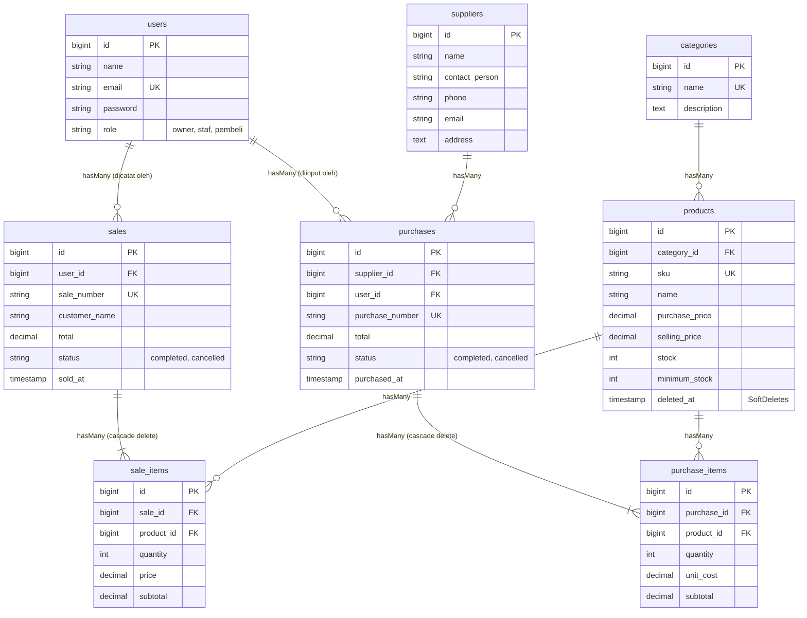

# Integrated Laravel Project: Inventory & Sales Management System (UTS Web Programming 2)

Aplikasi bisnis terintegrasi pengelolaan stok barang, pemasok, transaksi pembelian (*stock-in*), dan transaksi penjualan (*stock-out*) berbasis multi-peran (**Owner, Staf, dan Pembeli**). Dibangun menggunakan **Laravel**, **MySQL / SQLite**, **Eloquent ORM**, autentikasi kustom, otorisasi *role-based middleware*, validasi ketat *server-side*, serta konsistensi transaksi stok atomik menggunakan `DB::transaction()` dan `lockForUpdate()`.

---

## 1. Project Overview
Aplikasi ini dikembangkan untuk memecahkan kendala klasik pencatatan manual pada usaha distribusi:
- Mencegah ketidaksesuaian stok barang fisik dengan riwayat transaksi.
- Mencegah *overselling* (penjualan barang saat stok habis/tidak cukup).
- Mengamankan kalkulasi finansial (total dan subtotal dihitung di server, bukan dari browser).
- Memisahkan wewenang akses dengan ketat (Owner, Staf Operasional, dan Pembeli).
- Menyediakan dashboard eksekutif dengan query agregat *real-time* dan peringatan dini stok menipis (*low-stock alert*).

---

## 2. Requirements Sistem
- **PHP**: ^8.0.2 s/d ^8.2 (Teruji pada PHP 8.0.30 XAMPP Windows)
- **Composer**: ^2.2.0
- **Database**: MySQL (MariaDB XAMPP) atau SQLite
- **Web Server**: Apache XAMPP / Laravel Artisan Development Server

---

## 3. Akun Demo Pengujian (Slide 20)

| Peran (Role) | Email | Password | Akses & Wewenang |
| :--- | :--- | :--- | :--- |
| **👑 Owner** | `owner@example.com` | `password123` | Akses penuh: Master data (Kategori, Produk, Supplier), User Management, Dashboard Laporan, Pembatalan Transaksi PO/Sales (memulihkan stok). |
| **🧑‍💼 Staf** | `staf@example.com` | `password123` | Cek stok barang, Input Pembelian (Stock-in), Input Kasir Penjualan (Stock-out). Dilarang akses menu Owner. |
| **🛒 Pembeli** | `pembeli@example.com` | `password123` | Melihat katalog produk, stok & harga real-time, memesan langsung, serta riwayat belanja pribadi. |

> *Catatan: Pada halaman login terdapat tombol **Quick Demo** untuk mengisi otomatis kredensial masing-masing role secara instan.*

---

## 4. Panduan Instalasi & Setup Lingkungan Bersih (Reproducible Setup)

Ikuti langkah-langkah berikut untuk menjalankan proyek dari awal:

### Langkah 1: Clone atau Buka Folder Proyek
```bash
cd c:\xampp\htdocs\UTS_Web_Programming_2
```

### Langkah 2: Instalasi Dependency
*(Jika belum diinstal)*
```bash
composer install
```

### Langkah 3: Setup File Environment (`.env`)
Salin file `.env.example` menjadi `.env`:
```bash
cp .env.example .env
php artisan key:generate
```

### Langkah 4: Konfigurasi Database
Terdapat 2 opsi database yang siap pakai:

#### Opsi A: Menggunakan MySQL (XAMPP Default)
1. Nyalakan service **Apache** dan **MySQL** di XAMPP Control Panel.
2. Buat database baru bernama `uts_inventory` di phpMyAdmin (`http://localhost/phpmyadmin`).
3. Pastikan konfigurasi di `.env` sudah sesuai:
   ```env
   DB_CONNECTION=mysql
   DB_HOST=127.0.0.1
   DB_PORT=3306
   DB_DATABASE=uts_inventory
   DB_USERNAME=root
   DB_PASSWORD=
   ```

#### Opsi B: Menggunakan SQLite (Opsi Cepat Tanpa Menyalakan MySQL)
Gunakan baris berikut pada file `.env`:
```env
DB_CONNECTION=sqlite
```
*(File database SQLite telah tersedia di `database/database.sqlite`)*

### Langkah 5: Migrasi Database & Seeder Data Demo
Jalankan migrasi tabel terpadu beserta pengisian data awal (*seeder*):
```bash
php artisan migrate:fresh --seed
```

### Langkah 6: Menjalankan Server Lokal
```bash
php artisan serve
```
Akses aplikasi di browser melalui URL: `http://127.0.0.1:8000`

---

## 5. Entity Relationship Diagram (ERD) & Relasi Eloquent



### Penjelasan Relasi Eloquent (Slide 10)
1. **`Category hasMany Product`** & **`Product belongsTo Category`**: Satu kategori menampung banyak item produk.
2. **`Supplier hasMany Purchase`** & **`Purchase belongsTo Supplier`**: Pemasok menerbitkan banyak invoice faktur pembelian.
3. **`Purchase hasMany PurchaseItem`** & **`PurchaseItem belongsTo Purchase`**: Header pembelian berisi rincian item-item barang yang dibeli.
4. **`Product hasMany PurchaseItem`** & **`PurchaseItem belongsTo Product`**: Setiap detail item merujuk ke produk tertentu.
5. **`User hasMany Sale`** & **`Sale belongsTo User`**: Petugas kasir / customer yang melakukan transaksi.
6. **`Sale hasMany SaleItem`** & **`SaleItem belongsTo Sale`**: Transaksi penjualan menampung banyak jenis produk.
7. **`Product hasMany SaleItem`** & **`SaleItem belongsTo Product`**: Relasi pencatatan kuantitas terjual per produk.

---

## 6. Business Rules & Keamanan Data (Slide 8 & 16)

1. **Konsistensi Transaksi Stok Atomik (`DB::transaction`)**:
   Penyimpanan header transaksi, detail item, dan penyesuaian stok dibungkus dalam blok `DB::transaction()`. Jika salah satu baris gagal atau stok produk tidak mencukupi, seluruh proses di-*rollback* seketika. Tidak ada data setengah tersimpan.
2. **Pencegahan Race Condition & Overselling (`Product::lockForUpdate`)**:
   Saat mengecek dan mengurangi stok pada transaksi penjualan, sistem mengunci baris produk dengan `lockForUpdate()`. Hal ini mencegah *race condition* jika ada 2 transaksi memproses produk yang sama secara simultan.
3. **Kalkulasi Server-Side**:
   Harga satuan, subtotal, dan total transaksi diambil dan dihitung langsung dari basis data server, bukan dari input formulir browser yang rentan dimanipulasi melalui *Inspect Element*.
4. **Aturan Pembatalan Konsisten**:
   Transaksi yang telah berstatus *completed* tidak boleh disunting sembarangan. Pembatalan hanya dapat dilakukan oleh Owner, di mana sistem secara otomatis memulihkan stok kembali ke gudang (pada penjualan) atau menarik penambahan stok (pada pembelian) dengan validasi kecukupan stok.
5. **Integritas Master Data & Soft Delete**:
   Produk yang telah digunakan dalam transaksi tidak dihapus secara *hard delete*. Model menggunakan fitur `SoftDeletes` untuk menjaga keterikatan riwayat finansial lampau.

---

## 7. Bukti Pengujian Otomatis (Test Scenarios - Slide 19)

Aplikasi dilengkapi suite pengujian otomatis (`tests/Feature/UtsBusinessLogicTest.php`) yang mencakup 8 skenario utama di lembar tugas:

Untuk menjalankan pengujian:
```bash
php artisan test
```

### Hasil Eksekusi Test:
```text
   PASS  Tests\Unit\ExampleTest
  ✓ that true is true

   PASS  Tests\Feature\ExampleTest
  ✓ the application returns a successful response

   PASS  Tests\Feature\UtsBusinessLogicTest
  ✓ guest cannot access dashboard and invalid password is rejected
  ✓ duplicate sku is rejected and negative price is rejected
  ✓ successful purchase increases stock
  ✓ successful sale decreases stock
  ✓ sale with insufficient stock is rejected without data change
  ✓ atomicity transaction rollback when one item fails
  ✓ staff cannot access owner admin functions
  ✓ search filter and pagination yield correct records

  Tests:  10 passed
```

---

## 8. Panduan Menjawab Code Ownership Interview (Slide 24)

Berikut panduan penjelasan teknis jika dosen menanyakan poin-poin berikut saat sesi wawancara demo:

1. **Mengapa `Sale` memiliki relasi `hasMany` ke `SaleItem`?**
   > *Jawaban:* Karena satu transaksi penjualan faktur dapat memuat lebih dari satu jenis produk (*multi-item purchase*). Dengan memisahkan tabel header (`sales`) dan tabel detail (`sale_items`), data ternormalisasi dengan baik, memudahkan pencatatan kuantitas serta harga historis saat produk tersebut dijual tanpa redundansi data pelanggan.

2. **Di mana sistem memastikan stok tidak menjadi negatif?**
   > *Jawaban:* Pada method `store()` di `SaleController.php` (dan `CustomerOrderController.php`). Sebelum memanggil `$product->decrement('stock', $qty)`, sistem memvalidasi `if ($product->stock < $qty)` dan melempar `ValidationException` yang secara otomatis memicu pembatalan seluruh transaksi.

3. **Mengapa total penjualan dihitung di server?**
   > *Jawaban:* Untuk mencegah manipulasi harga dari sisi klien (*client-side tampering*). Jika total dihitung di browser, pengguna jahat dapat mengubah nilai atribut HTML atau request payload. Dengan mengambil `selling_price` langsung dari database produk dan menghitung total di server, integritas nominal uang terjamin.

4. **Apa risiko jika pengurangan stok dilakukan di luar `DB::transaction`?**
   > *Jawaban:* Jika terjadi kegagalan sistem di tengah proses (misalnya kesalahan server saat menyimpan item kedua), maka stok produk pertama sudah terlanjur berkurang atau header transaksi tersimpan tanpa detail item (*data orphaned / corrupt*). Dengan `DB::transaction`, seluruh perubahan dijamin bersifat *All-or-Nothing* (Atomik).

5. **Bagaimana mencegah Staff mengakses fungsi Admin melalui URL langsung?**
   > *Jawaban:* Menggunakan proteksi lapis ganda di *server-side*: rute dilindungi oleh middleware `auth` dan `role:owner` (`App\Http\Middleware\CheckRole`). Jika staf mencoba mengetikkan URL `/owner/dashboard` atau `/owner/categories`, middleware akan memeriksa `Auth::user()->role` dan mengeksekusi `abort(403, 'Unauthorized action')`.

6. **Apa yang terjadi jika dua penjualan memproses stok produk yang sama hampir bersamaan?**
   > *Jawaban:* Karena menggunakan `Product::lockForUpdate()`, database MySQL/InnoDB akan menerapkan *pessimistic exclusive locking*. Transaksi kedua harus menunggu hingga transaksi pertama selesai (*commit*). Setelah giliran tiba, transaksi kedua membaca nilai stok terbaru yang sudah berkurang sehingga tidak akan terjadi *overselling*.

7. **Tunjukkan validasi SKU unik dan jelaskan peran constraint database.**
   > *Jawaban:* Validasi dilakukan pada `ProductController.php` dengan aturan `'sku' => ['required', 'unique:products,sku']` untuk memberikan pesan error yang ramah kepada pengguna. Di sisi database, kolom `sku` didefinisikan `$table->string('sku')->unique()` pada migration file untuk menjamin bahwa pada tingkat mesin penyimpanan database tidak akan pernah terjadi duplikasi data.

8. **Ubah aturan minimum stock dan tunjukkan dampaknya.**
   > *Jawaban:* Nilai `minimum_stock` dapat disesuaikan pada menu Edit Produk. Di `DashboardController.php`, terdapat query `$lowStockProducts = Product::whereColumn('stock', '<=', 'minimum_stock')->get()`. Jika batas dinaikkan, produk tersebut otomatis masuk ke dalam daftar *Peringatan Stok Rendah* di Dashboard Owner dan Dashboard Staf.

---

## 9. Struktur Folder Views Sesuai Standar Penilaian
```text
resources/views/
├── layouts/
│   └── app.blade.php           (Template responsif Inter font & Bootstrap 5)
├── auth/
│   ├── login.blade.php         (Halaman login dengan tombol Quick Demo 3 Role)
│   └── register.blade.php      (Pendaftaran mandiri akun pembeli)
├── owner/
│   ├── dashboard.blade.php     (Dashboard eksekutif, agregat real-time, low-stock alert)
│   └── users/
│       ├── index.blade.php     (Manajemen akun & penetapan role)
│       ├── create.blade.php    (Form tambah user baru)
│       └── edit.blade.php      (Form ubah user & role)
├── staf/
│   └── dashboard.blade.php     (Dashboard operasional stock-in & stock-out)
├── customer/
│   └── dashboard.blade.php     (Katalog belanja, beli langsung, & riwayat belanja)
├── products/
│   ├── index.blade.php         (Katalog master produk, filter kategori & stok)
│   ├── create.blade.php        (Form produk baru + validasi SKU & harga)
│   ├── edit.blade.php          (Form perbarui produk & minimum stock)
│   └── show.blade.php          (Detail produk & buku pergerakan stok in/out)
├── categories/
│   ├── index.blade.php         (Daftar kategori + jumlah produk)
│   ├── create.blade.php        (Form tambah kategori)
│   └── edit.blade.php          (Form edit kategori)
├── suppliers/
│   ├── index.blade.php         (Daftar pemasok + kontak PIC)
│   ├── create.blade.php        (Form tambah supplier)
│   └── edit.blade.php          (Form edit supplier)
├── purchases/
│   ├── index.blade.php         (Daftar faktur pembelian PO + filter tanggal)
│   ├── create.blade.php        (Input PO multi-item dinamis)
│   └── show.blade.php          (Faktur PO cetak & opsi pembatalan)
└── sales/
    ├── index.blade.php         (Daftar invoice penjualan kasir + filter status)
    ├── create.blade.php        (Input kasir multi-item + validasi stok real-time)
    └── show.blade.php          (Invoice penjualan cetak & pembatalan pemulihan stok)
```
